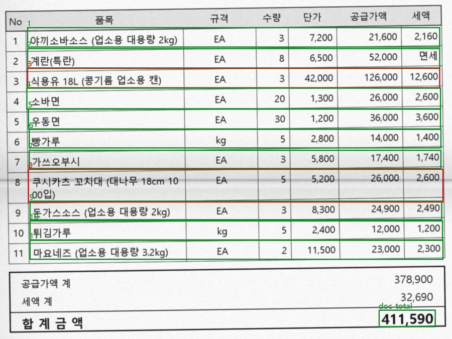
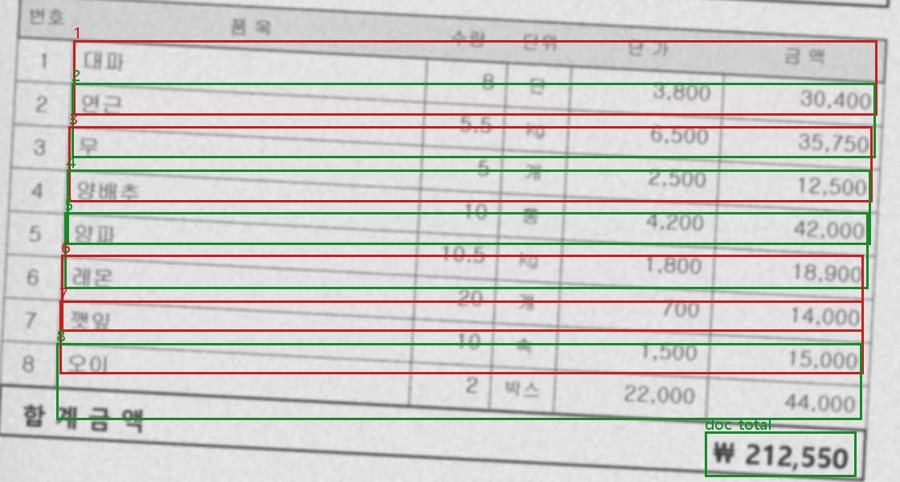
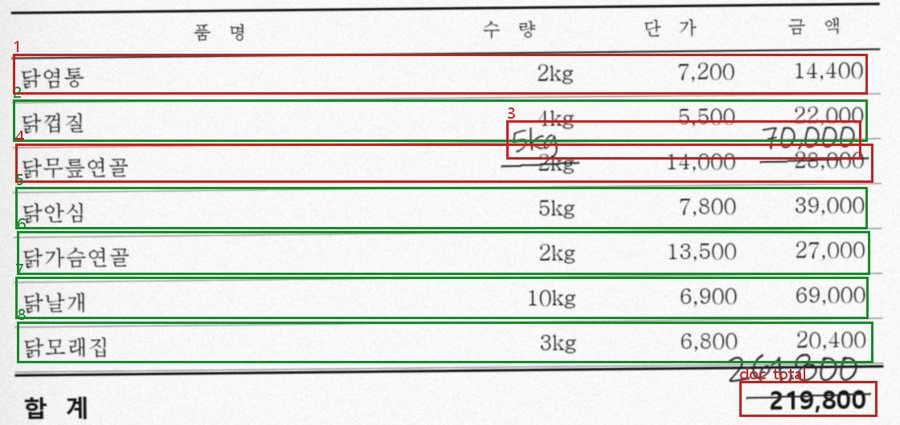

# invoice-ocr-poc · 거래명세서 엑셀 전사 PoC

이자카야에 거래처가 보내는 **거래명세서(스캔 PDF)를 노트북에서 읽어** 거래처·날짜·품목·수량·단가·합계를 행 단위로 뽑아내는지 확인한 PoC입니다.
틀린 값을 조용히 넘기지 않도록 **"사람이 확인해야 할 값"에 표시**를 붙이고, 값마다 **원본에서의 위치(박스)** 를 남깁니다.

- 모델: PaddleOCR PP-OCRv5 한국어(글자 검출·인식) + 규칙 기반 표 파싱, **노트북 CPU에서 실행, 외부 서비스로 자료를 보내지 않음**
- 자료: 직접 만든 **합성 명세서**(시험용 20장, 품목 102줄). 실제 명세서는 쓰지 않았습니다.
- 결론: 합성 시험용 20장에서 성공 기준 6개를 모두 넘었습니다. 구축을 결정하려면 실제 명세서로 다시 재야 합니다. → [docs/06_결론.md](docs/06_결론.md)

## 결과

| 기준 | 목표 | A. PP-OCRv5 한국어 + 규칙 파싱 | B. PaddleOCR-VL 1.6 |
|---|---|---|---|
| 품목 조용한 오류 | 102개 중 3 이하 | **0** | 13 |
| 필드(거래처·날짜·합계) 조용한 오류 | 60개 중 1 이하 | 0 | 0 |
| "확인 필요"로 넘긴 비율 | 20% 이하 | 18.5% | 6.2% |
| 합계 불일치 표시 | 20/20장 | 20/20 | 19/20 |
| 값마다 원본 위치 | 100% | 100% (줄 단위) | 92.6% (표 단위) |
| 처리 시간 (장당 평균, CPU) | 60초 이하 | **16.6초** | 174.5초 |

- "조용한 오류"는 틀렸는데 "확인 필요" 표시도 안 된 값입니다. 틀려도 표시가 붙었다면 사람이 잡을 수 있으므로 따로 셉니다.
- B는 정확도는 괜찮았지만 신뢰도와 줄 위치를 주지 않고 표 구조가 불안정해 이 업무에는 맞지 않았습니다. 상세: [docs/05_결과비교.md](docs/05_결과비교.md)
- 후보 C(Qwen3-VL-2B)는 설치하지 않아 시도하지 않았습니다.

## 시연

박스 그림입니다. **초록 = 그대로 통과, 빨강 = 사람 확인 필요**, 숫자는 줄 번호입니다.


*복잡한 양식(19번). 줄 박스가 품목 줄에 맞고, 줄바꿈된 품목명도 한 박스로 묶였습니다. 3번과 8번 줄은 글자 신뢰도가 0.90보다 낮아 확인 필요(빨강)가 붙었지만 읽은 값은 모두 맞습니다(불필요한 확인 필요).*


*기울어진 저화질 스캔(18번). 값은 줄마다 맞게 묶였지만 박스가 위아래 두 줄에 걸칩니다. **알려진 한계**입니다.*


*손글씨로 고친 납품서(17번). 정정을 이해한 것은 아니고, 취소선 글자의 신뢰도가 낮고 손글씨가 어긋난 줄로 읽혀 확인 필요가 붙었습니다. **알려진 한계**입니다.*

### 엑셀 행 초안 (최종 출력)

[`examples/ledger_A_test20.xlsx`](examples/ledger_A_test20.xlsx)(CSV: [`ledger_A_test20.csv`](examples/ledger_A_test20.csv))는 시험용 20장의 결과입니다.
- **장부 초안** 시트: 품목 한 줄이 한 행입니다(103행). 확인 필요 행은 **노란색**이고(25행. 문서 필드 5개를 더하면 슬롯 162개 중 30개로, 위 결과표의 18.5%와 같은 값입니다), 사유와 원본 위치가 함께 적힙니다. 마지막 "확인 완료" 열은 사람이 확인한 뒤 표시하는 빈 칸입니다. AI는 초안만 만들고 반영은 사람이 합니다.
- **문서 요약** 시트: 문서당 한 행. 품목 금액의 합과 문서 합계를 나란히 놓아 합계 불일치(20번)와 확인 필요 항목을 보여 줍니다.
- 품목이 103행인 이유: 정답은 102줄인데 17번(손글씨 정정)에서 손글씨가 별도 줄로 읽혀 1줄이 더 생겼고, 그 줄은 확인 필요로 표시됩니다.

## 빠른 시작: 재현하기

필요한 것: **Python 3.13**, 인터넷(패키지와 모델 내려받기), 디스크 여유 약 1.2GB(새 가상환경 약 1GB + 모델 약 0.1GB, 2026-11-18 측정). GPU는 필요 없습니다(paddlepaddle CPU 빌드).

```bash
python -m venv .venv
```
```bash
.venv\Scripts\activate
```
(macOS·Linux는 `source .venv/bin/activate`)
```bash
pip install -r requirements.txt
```
```bash
python -X utf8 src/prepare_a.py
```
```bash
python -X utf8 -W ignore src/reproduce.py
```

- `prepare_a.py`: 모델 두 개(약 100MB)를 공식 Hugging Face 저장소에서 **고정한 리비전**으로 받고 가중치 해시를 확인합니다. **네트워크를 쓰는 유일한 단계**입니다. 실행 스크립트는 파이썬의 외부 연결을 막고 돕니다.
- `reproduce.py`: 시험용 20장에 후보 A를 돌려 채점하고 저장소의 기대 결과(`expected/`)와 비교합니다. 약 6분 걸립니다(CPU 스레드 20개 기준, 코어가 적으면 더 걸림).

기대하는 출력:

```text
1_품목_조용한오류: 기대 0 / 실제 0 일치
2_필드_조용한오류: 기대 0 / 실제 0 일치
3_확인필요_비율: 기대 0.1852 / 실제 0.1852 일치
4_합계불일치_표시: 기대 20/20장 일치 / 실제 20/20장 일치 일치
5_위치_추적: 기대 1.0 / 실제 1.0 일치
6_처리시간: 평균 17.25초 (기대 환경 16.59초, 기준 60초 이하) 통과
예측 값 전체 비교: 같음 (참고 정보)
재현 성공: 기준 값이 기대 결과와 같습니다.
```

처리 시간은 컴퓨터마다 달라서 비교하지 않고 60초 이하인지만 봅니다.

**한 장만 돌려 보려면** (약 20초). `--export`를 붙이면 엑셀과 CSV까지 만듭니다. 결과는 `outputs/A/<실행시각>/`에 저장됩니다: `ledger.xlsx`, `ledger.csv`(엑셀 행 초안), `predictions.json`(값, 확인 필요 표시, 박스), `overlay/*.png`(박스 그림).

```bash
python -X utf8 -W ignore src/run_a.py --pdf-dir sample-invoices-fix17 --export
```

이미 있는 실행 결과로 엑셀만 다시 만들려면(이미 있는 파일은 덮어쓰지 않습니다):

```bash
python -X utf8 src/export_xlsx.py --pred outputs/A/<실행시각>/predictions.json --out ledger.xlsx --csv ledger.csv
```

### 재현을 확인한 범위 (2026-11-18)
- **확인함**: 같은 Windows 11 + Python 3.13 컴퓨터에서 **새 가상환경을 만들고 모델 캐시를 비운 채** 위 순서대로 따라 해서 "재현 성공"이 나왔고, 예측 값 전체가 20장 모두 기대 결과와 같았습니다. 같은 컴퓨터에서 두 번 돌려도 시간을 뺀 예측이 같았습니다.
- **확인하지 못함**: 다른 OS, 다른 파이썬 버전, 다른 CPU. 코드에 `enable_mkldnn=False`를 넣은 것은 이 환경에서 oneDNN 오류를 피하려는 우회입니다.
- `pip install`이 PyMuPDF와 함께 `pymupdf-layout`, `pymupdf4llm`, `onnxruntime`도 설치합니다. 동작에는 쓰지 않습니다.
- 후보 B(선택 사항)는 `requirements-b.txt`와 `src/prepare_b.py`(모델 약 2GB), `src/run_b.py`로 돌릴 수 있고 20장에 약 70분 걸립니다. 재현 대상이 아닙니다.

## 구성

| 경로 | 내용 |
|---|---|
| `src/run_a.py`, `src/table_parse.py` | 후보 A: PDF → 글자 인식 → 줄·표 조립 → 값, 확인 필요 표시, 박스 |
| `src/score.py`, `src/test_score.py` | 채점기(모델 실행 전에 규칙 고정)와 테스트 24개 |
| `src/export_xlsx.py`, `src/test_export.py` | 결과 → 엑셀·CSV 행 초안, 테스트 9개 |
| `src/measure.py`, `src/test_measure.py`, `measurement/` | 수기 입력 vs AI 보조 측정 도구(테스트 19개)와 기록 시트(아직 비어 있음) |
| `src/reproduce.py`, `src/prepare_a.py` | 재현 확인, 모델 준비 |
| `src/run_b.py`, `src/prepare_b.py` | 후보 B (선택 사항) |
| `src/common.py` | PDF 렌더링, 파이썬 외부 연결 차단, 박스 그림 |
| `sample-invoices/` | **시험용** 합성 명세서 20장 + 정답(`정답.json`, `정답_품목.csv`) + `채점규칙.md` |
| `sample-invoices-fix17/` | 17번 샘플 결함을 고친 PDF(아래 참고) |
| `dev-invoices/` | **개발용** 합성 명세서 20장(다른 시드). 파서는 여기서만 다듬음 |
| `expected/` | 재현 확인의 기대 결과 |
| `examples/` | 시험용 20장의 엑셀·CSV 행 초안 예시 |
| `results/` | 채점 결과(`test_*` = 시험용, `dev_*` = 개발용) |
| `make_invoices.py` | 합성 명세서 생성기. Windows 글꼴을 써서 다른 OS에서는 돌지 않고, 다시 만들면 PDF가 바이트까지 같지 않습니다. 그래서 만들어 둔 PDF를 저장소에 넣었습니다 |
| `docs/` | 단계별 문서 |

## 자료에 대해
- 모든 상호·번호·인명은 가상입니다. 개인정보와 실제 거래 내역은 없습니다. 품목은 공개된 메뉴판에서 뽑았습니다.
- 시험용 20장은 **개발에 쓰지 않았고** 후보마다 설정을 고정한 뒤 한 번씩 돌렸습니다.
- **17번(손글씨 정정) 샘플 결함**: 줄 그은 인쇄 금액이 정정 전 값 `28,000`이어야 하는데 `70,000`으로 찍혀 있었습니다. 정답은 맞고 PDF 그림만 틀렸습니다. 고친 PDF는 `sample-invoices-fix17/`에 따로 있고, 고친 것으로 A를 다시 쟀을 때도 결과는 같았습니다(조용한 오류 0). 다만 이유가 다릅니다(위 그림 설명). `sample-invoices/`의 17번은 결함이 있는 원래 파일 그대로입니다. → [docs/04_오류분석.md](docs/04_오류분석.md)

## 한계
- **현행 수준(직원이 직접 입력하는 시간과 오류)을 재지 않았습니다.** 성공 기준의 숫자는 예시 기준을 빌렸고 처리 시간 60초는 잠정값입니다. A가 사람보다 낫다고는 말할 수 없습니다.
- **합성 샘플만으로 쟀습니다.** 실제 서류의 번짐, 인쇄 불량, 거래처별 양식 차이가 빠져 있습니다.
- A의 파서는 양식 3종의 모양을 개발 중에 봤습니다. 다른 양식이 오면 다시 손봐야 합니다.
- 손글씨 정정은 **이해하지 못합니다.** 신뢰도가 낮아져 우연히 걸렸을 뿐이라 선명한 손글씨는 조용히 통과할 수 있습니다.
- 기울어진 스캔에서 박스가 옆 줄까지 덮습니다. 채점기는 박스 형식만 봐서 위치 기준을 100%로 셌습니다.
- "확인 필요" 비율이 18.5%로 한계(20%)에 가깝고, 그중 14개는 맞는 값에 붙은 것입니다.
- 비교한 후보가 Paddle 계열 둘뿐입니다. 범용 모델(C)은 시도하지 않았습니다.
- 네트워크 차단은 파이썬 소켓까지만 확인했습니다(두 후보 모두 외부 연결 시도 0건).
- PyMuPDF는 AGPL 또는 상용 라이선스입니다. 제품에 넣어 배포하려면 라이선스를 정하거나 다른 PDF 렌더러로 바꿔야 합니다.

## 아직 없는 것
- 웹 화면 같은 **데모**(지금은 엑셀 파일과 박스 그림 파일로 확인합니다)
- **기존 방식(직원 수기 입력)과의 시간·정확도 비교** — 측정 도구와 절차는 준비됐고 아직 재지 않았습니다([docs/07_수기입력_측정절차.md](docs/07_수기입력_측정절차.md))
- **실제 명세서**로 재측정(거래처명·단가를 가린 5~10장)

## 문서
| 단계 | 문서 |
|---|---|
| **문제 정의서** (도메인, 현재 문제, 개선 가설, 대상 사용자, 성공 기준) | [docs/00_문제정의서.md](docs/00_문제정의서.md) |
| 업무 정의 (업무 유형, 적용하지 않을 조건) | [docs/01_업무정의.md](docs/01_업무정의.md) |
| 성공 기준 (모델 실행 전 고정) | [docs/02_성공기준.md](docs/02_성공기준.md) |
| 후보 선정과 걸러내기, 모델 선정 근거 | [docs/03_후보표.md](docs/03_후보표.md) |
| 채점기 규칙 | [docs/채점기_규칙.md](docs/채점기_규칙.md) |
| 실행·채점 결과 비교 | [docs/05_결과비교.md](docs/05_결과비교.md) |
| 오류 분석(박스 그림 검산, 실패 사례) | [docs/04_오류분석.md](docs/04_오류분석.md) |
| 결론과 회고 | [docs/06_결론.md](docs/06_결론.md) |
| 수기 입력 대비 측정 절차 (기준 7) | [docs/07_수기입력_측정절차.md](docs/07_수기입력_측정절차.md) |

환경: Windows 11, Python 3.13, paddleocr 3.7.0, paddlepaddle 3.3.1(CPU 빌드). 라이선스·버전은 바뀝니다. 확인 날짜와 근거는 `docs/03_후보표.md`.
